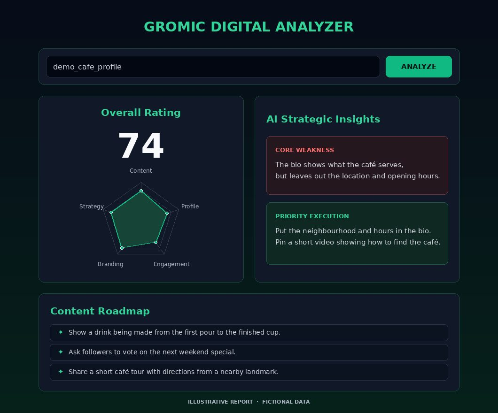

# Social Media Analyzer

Social Media Analyzer is a Chrome extension for Instagram, Facebook, and TikTok. It uses the bio and recent captions it can read from a profile to suggest ways to improve the profile and plan new content.

[Open the report dashboard](https://social-analyzer-extension.vercel.app/)

## Install in Chrome

1. Select **Code → Download ZIP** on this repository and extract the ZIP.
2. Open `chrome://extensions` in Chrome and turn on **Developer mode**.
3. Select **Load unpacked** and choose the extracted folder that contains `manifest.json`.

## View a report

1. Open a public Instagram, Facebook, or TikTok profile and wait for it to load.
2. Open **Social Analyzer Scraper** from the extensions menu and click **Analyze Profile**.
3. When the popup says the analysis was saved, open the dashboard. Enter the handle shown in the popup without the leading `@` and click **Analyze**.

The dashboard shows AI-estimated scores, a priority fix, and content ideas. The extension sends the profile details to its API and saves a report for lookup by handle.

## Sample report

This illustrative preview uses fictional data for a café profile.

